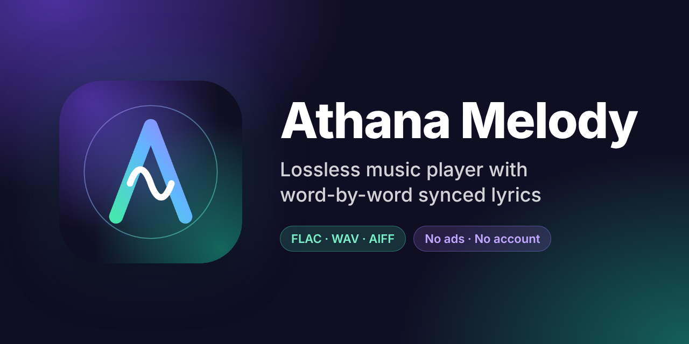
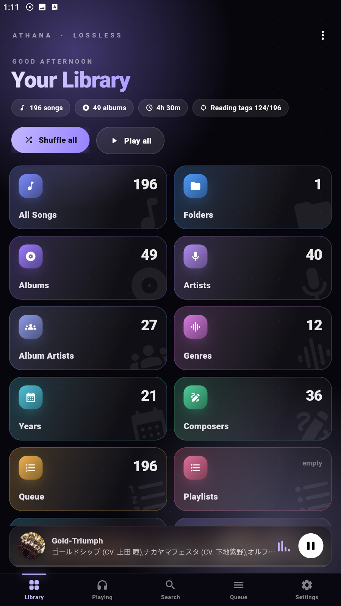
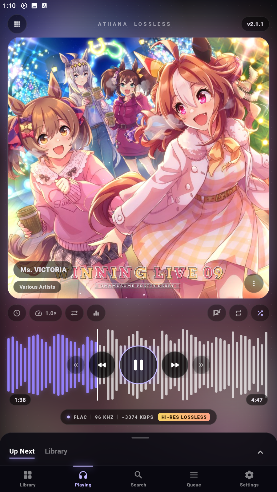
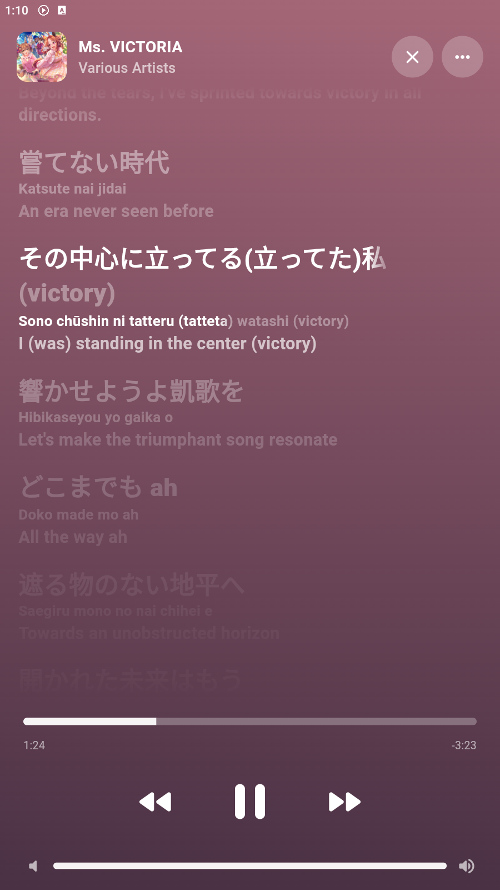

<div align="center">



<br>

[](https://github.com/Kanatahiroshi25/Athana-Release/releases/latest)
[](https://github.com/Kanatahiroshi25/Athana-Release/releases)
[](#download)
[](LICENSE)

**[⬇️ Download for Android](https://github.com/Kanatahiroshi25/Athana-Release/releases/latest)** &nbsp;·&nbsp;
**[🌐 Open the web app](https://kanatahiroshi25.github.io/Athana-Release/)** &nbsp;·&nbsp;
**[✨ Features](#features)** &nbsp;·&nbsp;
**[🔒 Privacy](#privacy)** &nbsp;·&nbsp;
**[⚠️ Disclaimer](#disclaimer)**

</div>

---

## About

**Athana Melody** plays your own music files the way they were recorded, and shows the lyrics the way you would see them in a streaming app: the line being sung fills in **word by word**, with romaji and translation underneath.

- 🎧 **Every format.** MP3, AAC, M4A, OGG, Opus, FLAC, WAV, AIFF and more play in one place, and lossless files reach the audio output untouched.
- 🎤 **Lyrics that follow the singer.** Synced line by line and word by word, found online or loaded from your own `.lrc` file.
- 🔒 **Yours alone.** No account, no ads, no tracking. Your music never leaves your device.

> **Unofficial and independent.** Athana Melody is not affiliated with or endorsed by YouTube, Google or any music service. It hosts no music. See the [disclaimer](#disclaimer).

> Athana Melody is a work in progress. Ideas and bug reports are welcome in the [Issues](https://github.com/Kanatahiroshi25/Athana-Release/issues) tab.

## Download

| Platform | How to get it |
| --- | --- |
| **Android** | Download the `.apk` from the [latest release](https://github.com/Kanatahiroshi25/Athana-Release/releases/latest), open it, and allow installs from your browser if Android asks. After that the app tells you when an update is ready. |
| **Web** | Open the [web app](https://kanatahiroshi25.github.io/Athana-Release/) in Chrome or Edge. Nothing to install. |

<!--
SCREENSHOTS: add three phone screenshots to the docs folder, then delete the first and last line of this comment (the lines with the arrows) so the table shows.

| Library | Now playing | Lyrics |
| :---: | :---: | :---: |
|  |  |  |
-->

## Features

### 🎤 Lyrics
- Full-screen lyrics page in the Apple Music style, with colours taken from the cover art
- Word-by-word fill on the line being sung, with smooth scrolling
- Romaji and translation under each line
- Finds lyrics online (LRCLIB, NetEase Cloud Music), reads lyrics inside your files, or loads your own `.lrc`
- Romaji for Japanese and Korean, and Korean plus kana-only Japanese lines work with no internet
- Back up and restore your saved lyrics in one file
- Words that have no timing yet are timed from the line, so every synced song fills in word by word

### 🎧 Sound
- Plays FLAC, WAV, AIFF, MP3, AAC, OGG and Opus
- Athana's own FLAC decoder and audio output: 24-bit songs reach your phone at 24-bit, with a safety net that falls back to Android's own code if anything keeps failing. A USB DAC can get them bit-perfect on Android 14 and later *(beta)*
- 10-band equalizer with a preamp, presets and a Strength slider
- Mixer: balance, stereo expand, tempo, mono, volume trim and crossfeed for headphones
- Loudness normalisation, so every song is about the same volume
- Separate sound settings for the speaker, wired output and each Bluetooth device
- Analyse a song: spectrogram, true hi-res check, real bit depth, loudness, peak and dynamic range
- **Hi-Res check:** a Hi-Res song is measured once in the background and shown as verified, upsampled or padded, with its file rate next to what the device receives, and a gold badge on the cover when it is real
- Signal path view that shows the route the sound takes

### 📚 Library
- Albums, artists, folders and a search box inside every list, in a full-screen library
- Playlists, Liked songs, Recently added, Recently played and Most played
- Shuffle all, Play all, and an A to Z quick index
- Edit a song's title, artist and cover without touching the file
- Link folders once. New songs and songs that came back are found for you

### ☁️ Google Drive and offline copies *(Android)*
- Pick songs from Google Drive and play them straight away
- **Get the next song ready:** the next one or two Drive songs are fetched into a temporary space while one plays, so Next starts at once, and nothing is kept
- Save copies on the phone so they play with no internet: **Songs I play**, **Save all** or **Don't save**
- Storage limit, Wi-Fi only option, and a background download you can pause
- The songs played longest ago are removed first when space runs low

### ▶️ YouTube Music *(Android, streaming only)*
- **Home** with mood chips, Quick picks, *Keep listening* (the artists you played lately) and the rest of the YouTube Music feed. Tap a playlist, album or artist to see its songs first
- **Search** songs, videos and playlists from one place
- **Streaming only.** Athana plays the sound while you listen. It does not save YouTube audio on your phone
- **Up next** list, and related songs that keep playing when a song ends (switch it off with *Auto*)
- Your own playlists, kept on your phone
- Lyrics for the song that plays, with manual search

### 🎛️ Controls
- Double-tap or press and hold the cover to run an action you choose
- Headphone button actions for one, two and three presses
- Sleep timer that fades the music out
- Bluetooth keyboard shortcuts
- Your own wallpaper, Aurora background, Performance mode and Focus mode

## Privacy

Athana Melody has no account and no tracking. It only goes online when you ask it to:

| What | Why | Can be switched off |
| --- | --- | --- |
| Lyrics search | Looks songs up on LRCLIB and NetEase Cloud Music | Yes |
| Translation | Sends the lyric text to Google Translate | Yes |
| Romaji for lines with kanji | Sends those lines to Google Translate. Korean and kana-only Japanese lines are read on your phone and never leave it | Yes |
| Find cover and tags | Only when you tap it: sends the song title and artist to MusicBrainz and fetches the cover from the Cover Art Archive | Yes |
| YouTube Music | Home feed, search and streaming load from YouTube's public pages when you open Home or play a song. Nothing is sent from your library | Yes (Offline mode) |
| Google Drive songs | Reads the songs you picked, through Android | Only used if you add Drive songs |
| Update check | Asks GitHub once a day for the latest release | Yes |

Everything else (your library, playlists, covers and options) stays on your device. There is also an **Offline mode** that blocks every online feature at once.

## Disclaimer

Athana Melody is an independent, unofficial project. It is **not affiliated with, endorsed by or sponsored by YouTube, Google or any music service**, and all names and trademarks belong to their owners.

- Athana **does not host, store or distribute** any music, video, lyrics or cover art. Your own files stay on your phone, Drive songs come from your own Drive, and YouTube features only stream from YouTube while you listen.
- The YouTube features use unofficial interfaces that YouTube has not approved. They can stop working at any time, and using them may not comply with YouTube's Terms of Service. Whether to use them is your decision, and you are responsible for following the terms and laws that apply to you.
- Lyrics, covers and songs belong to their writers, artists and labels.
- The software is provided **as is**, without any warranty (see the licence).

The full text is in [DISCLAIMER.md](DISCLAIMER.md). A rights holder who wants something removed can open an issue in the [Issues](https://github.com/Kanatahiroshi25/Athana-Release/issues) tab.

## Source code and building

Athana Melody is free software under the **GNU General Public License v3.0**, and the full source code of the Android app is in this repository. To build it you need the [Flutter SDK](https://docs.flutter.dev/get-started/install) and the Android SDK:

```
flutter pub get
flutter build apk --release
```

The signing key of the official releases is private and is not part of the source. A build you make yourself is signed with your own key, so it installs next to the official app only after you remove it.

## Built with

- [Flutter](https://flutter.dev) for the Android app
- [Media3 ExoPlayer](https://developer.android.com/media/media3/exoplayer) for playback, with Athana's own FLAC decoder and audio output on top
- [NewPipe Extractor](https://github.com/TeamNewPipe/NewPipeExtractor) and [dart_ytmusic_api](https://pub.dev/packages/dart_ytmusic_api) for reading YouTube Music
- Plain HTML and JavaScript for the web app

## Credits

Lyrics are provided by [LRCLIB](https://lrclib.net) and NetEase Cloud Music, and translation by Google Translate. The lyrics themselves belong to their writers and publishers. Song details come from [MusicBrainz](https://musicbrainz.org) and cover pictures from the [Cover Art Archive](https://coverartarchive.org); the covers belong to their artists and labels.

## Support

Athana is free, has no ads and no tracking, and is made by one person. If it is useful to you, you can chip in on Saweria or Trakteer (links in the app, under Settings → About). It is never required and nothing is locked.

## License

Released under the [GNU General Public License v3.0](LICENSE). You may use, study, share and change it, and any version you share must stay under the same licence with its source available.

<div align="center">

Made with ♥ by **Kanata Hiroshi** ([@Kanatahiroshi25](https://github.com/Kanatahiroshi25))

</div>
