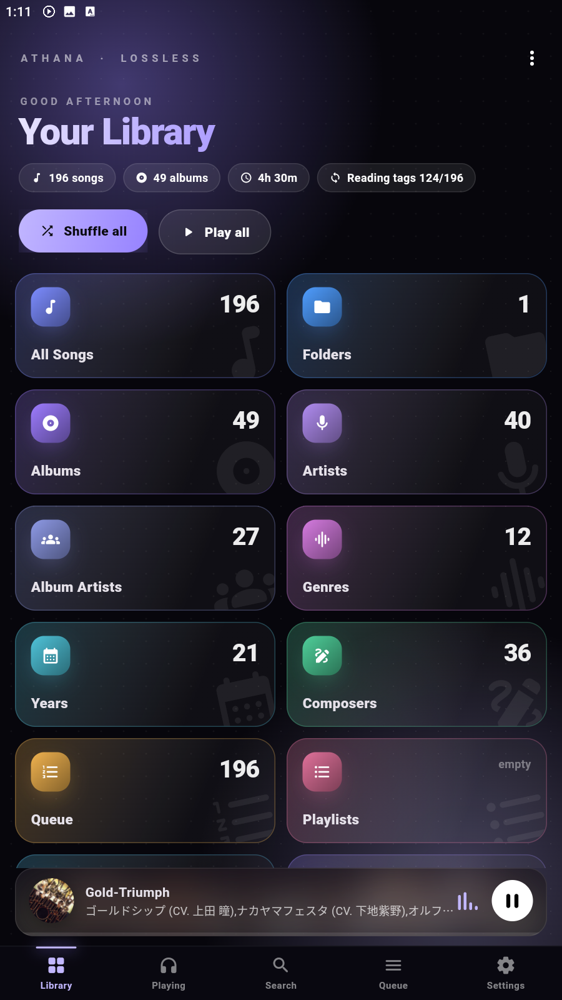
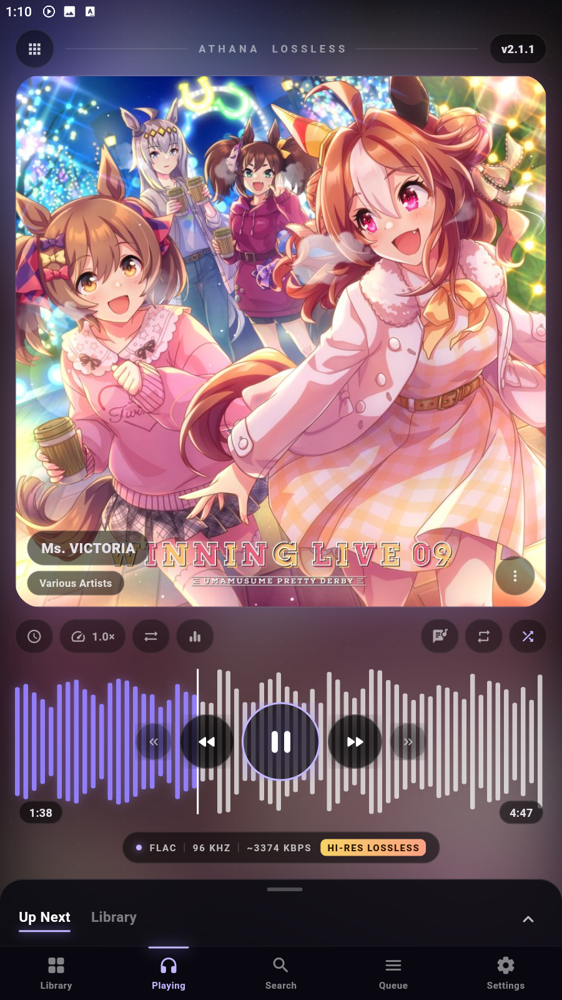
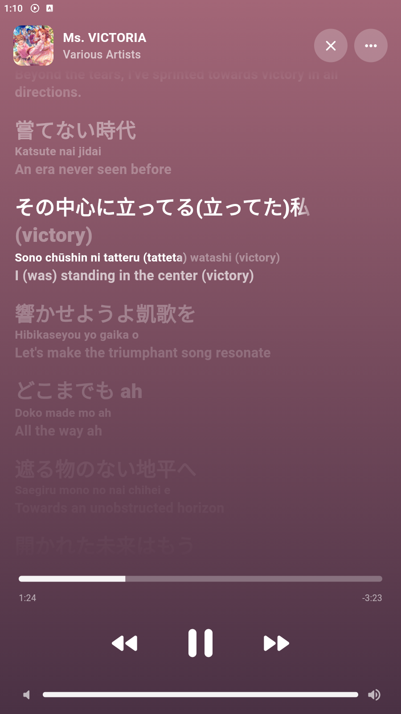

 

**[⬇️ Download for Android](https://github.com/Kanatahiroshi25/Athana-Release/releases/latest)** &nbsp;·&nbsp;
**[🌐 Open the web app](https://kanatahiroshi25.github.io/Athana-Release/)** &nbsp;·&nbsp;
**[✨ Features](#features)** &nbsp;·&nbsp;
**[🔒 Privacy](#privacy)**
**📜 Changelogs: [Android app](CHANGELOG-ANDROID.md) · [Web app](CHANGELOG.md)**

---

## About

**Athana Melody** plays your own music files the way they were recorded, and shows the lyrics the way you would see them in a streaming app: the line being sung fills in **word by word**, with romaji and translation underneath.

- 🎧 **Lossless.** FLAC, WAV and AIFF reach the audio output untouched.
- 🎤 **Lyrics that follow the singer.** Synced line by line and word by word, found online or loaded from your own `.lrc` file.
- 🔒 **Yours alone.** No account, no ads, no tracking. Your music never leaves your device.

> Athana Melody is a work in progress. Ideas and bug reports are welcome in the [Issues](https://github.com/Kanatahiroshi25/Athana-Release/issues) tab.

## Download

| Platform | How to get it |
| --- | --- |
| **Android** | Download the `.apk` from the [latest release](https://github.com/Kanatahiroshi25/Athana-Release/releases/latest), open it, and allow installs from your browser if Android asks. After that the app tells you when an update is ready. |
| **Web** | Open the [web app](https://kanatahiroshi25.github.io/Athana-Release/) in Chrome or Edge. Nothing to install. |

SCREENSHOTS:

| Library | Now playing | Lyrics |
| :---: | :---: | :---: |
|  |  |  |

## Features

### 🎤 Lyrics
- Full-screen lyrics page in the Apple Music style, with colours taken from the cover art
- Word-by-word fill on the line being sung, with smooth scrolling
- Romaji and translation under each line
- Finds lyrics online (LRCLIB, NetEase Cloud Music), reads lyrics inside your files, or loads your own `.lrc`
- Words that have no timing yet are timed from the line, so every synced song fills in word by word

### 🎧 Sound
- Plays FLAC, WAV, AIFF, MP3, AAC, OGG and Opus
- 10-band equalizer with a preamp, presets and a Strength slider
- Mixer: balance, stereo expand, tempo, mono, volume trim and crossfeed for headphones
- Loudness normalisation, so every song is about the same volume
- Separate sound settings for the speaker, wired output and each Bluetooth device
- Analyse a song: spectrogram, true hi-res check, real bit depth, loudness, peak and dynamic range
- Signal path view that shows the route the sound takes

### 📚 Library
- Albums, artists, folders and search in a full-screen library
- Playlists, Liked songs, Recently added, Recently played and Most played
- Shuffle all, Play all, and an A to Z quick index
- Edit a song's title, artist and cover without touching the file
- Link folders once. New songs and songs that came back are found for you

### ☁️ Google Drive and offline copies *(Android)*
- Pick songs from Google Drive and play them straight away
- Save copies on the phone so they play with no internet: **Songs I play**, **Save all** or **Don't save**
- Storage limit, Wi-Fi only option, and a background download you can pause
- The songs played longest ago are removed first when space runs low

### 🎛️ Controls
- Double-tap or press and hold the cover to run an action you choose
- Headphone button actions for one, two and three presses
- Sleep timer that fades the music out
- Bluetooth keyboard shortcuts
- Your own wallpaper, Aurora background, Performance mode and Focus mode

## Privacy

Athana Melody has no account and no tracking. It only goes online when you ask it to:

| What | Why | Can be switched off |
| --- | --- | --- |
| Lyrics search | Looks songs up on LRCLIB and NetEase Cloud Music | Yes |
| Translation | Sends the lyric text to Google Translate | Yes |
| Google Drive songs | Reads the songs you picked, through Android | Only used if you add Drive songs |
| Update check | Asks GitHub once a day for the latest release | Yes |

Everything else (your library, playlists, covers and options) stays on your device. There is also an **Offline mode** that blocks every online feature at once.

## Built with

- [Flutter](https://flutter.dev) for the Android app
- [Media3 ExoPlayer](https://developer.android.com/media/media3/exoplayer) for playback
- Plain HTML and JavaScript for the web app

## Credits

Lyrics are provided by [LRCLIB](https://lrclib.net) and NetEase Cloud Music, and translation by Google Translate. The lyrics themselves belong to their writers and publishers.

## License

Released under the [MIT License](LICENSE).

Made with ♥ by **Kanata Hiroshi** ([@Kanatahiroshi25](https://github.com/Kanatahiroshi25))

